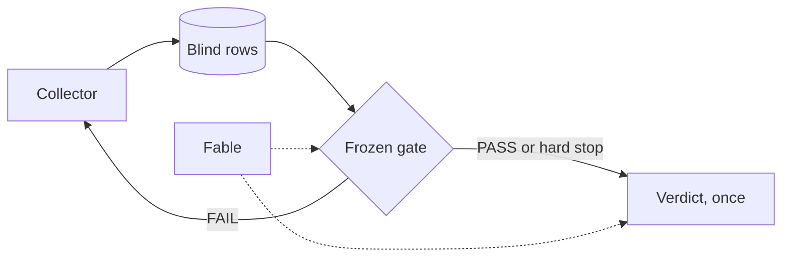

# llm-news-drift

My pre-registered test, with git history from the day I planned it.

## The question

I give Claude Haiku 4.5 one headline and its ticker, nothing else. It answers
POSITIVE, NEGATIVE or NEUTRAL. Does that answer predict the sign of the
stock's next-session return in excess of its band's equal-weighted move? The
band is US common stocks with 2.07 to 65.3 million USD median daily dollar
volume. I sample 400 a quarter, in four liquidity strata. The primary tests
read the gross excess. Trading cost is a secondary question.

## Why it is pre-registered

Choices made after seeing the data can find a pattern in almost any data set.
So I fixed every choice in EXPERIMENT.md and accepted it on 2026-07-28, before
any observation row existed. [KIROS: confirm] It sets four primary tests at
|z| >= 2.50, a bootstrap over trading days and a within-day permutation null.
A clear positive may say only "the pipeline predicts", never "the model
understands". Each change is a dated amendment. Amendment 10 locks the file
until the readout, except to fix a demonstrated defect.

## How it works

Each weekday the collector in news_experiment/ pulls company news from
Finnhub, drops duplicates and sends each eligible headline to Haiku at
temperature 0. Rows end in five states: `no_news`, `judged`, `model_failed`,
`excluded_pre_call` or `source_failed`. A missed session is never backfilled.

Nobody reads a return, excess, benchmark or cost column before the readout
(CLAUDE.md). In news_eval/ only the gate and the verdict read real outcomes,
from a snapshot with a valid unlock file. A sha256 manifest freezes the
harness. The gate checks power: at least 60 day clusters and 1,000 scorable
rows, and enough of them to detect a 30 bp effect. Claude Fable independently
recomputes every gate and verdict number.

## Status on 2026-11-07

- **Collecting since 2026-07-28.** The 2026-11-06 snapshot: 34,550 collection
  rows, 68 query dates, 12,614 judged.
- **The gate failed on 2026-10-28 (C.2) and 2026-11-06 (C.2b)**, both on
  power. C.2 failed because the excess-return sigma was 442.1 bp, not the 180
  bp assumed. Sigma says nothing about the sign or size of any effect.
- **Amendment 10** runs the verdict once at the 120th trading session if no
  gate passes first, labelled "registered power rule NOT met". C.3 dated that
  hard stop 2027-01-15, built its path and re-froze the harness. I expect the
  readout in January 2027.
- **Permanent gaps.** The collector refused 2026-08-28 and 2026-09-15 because
  almost none of the band had a price bar yet. Why is not recorded.
  [KIROS: confirm] A shutdown killed the run for 2026-10-30, and killed runs
  are not retried. Likely cause: sleep was masked, so I shut the laptop down
  to carry it. [KIROS: confirm] 2026-10-22 has no judgments: the experiment
  credit ran out.
- **No result yet, and no claim.** No effect has been computed.

## Repository map

- EXPERIMENT.md: the pre-registration.
- news_experiment/, ops/systemd/: the collector and its timer.
- news_eval/: the harness. tests/: synthetic tests.
- reports/: stage returns, reviews, rulings, freeze manifests, gate log and
  snapshot metadata.
- docs/: stage plan, decisions, prompt rules, stage prompts.
- CLAUDE.md, .claude/: the Claude Code session rules.
- COLLECTION_LOG.md: one entry per run, last committed on 2026-10-02.
- scripts/: the B.2 blind interim read.
- backtest/, llm_consensus/ and others: AiTrader code the collector and tests
  import.
- ALLOWLIST.txt, EXCLUDE.txt, extract.sh: how I cut this from AiTrader.
  LICENSE_NOTE.md: the licence.

Not here: the headline and snapshot databases, any key, the trading engine.

## More

- [docs/TIMELINE.md](docs/TIMELINE.md): every dated event, with commits.
- [docs/HOW_TO_VERIFY.md](docs/HOW_TO_VERIFY.md): check it yourself.
- [docs/AI_USE.md](docs/AI_USE.md): how I used Claude, and what went wrong.

My working repository, AiTrader (https://github.com/kirosli00tuff/AiTrader),
stays public until the January 2027 readout as the dated audit trail.
